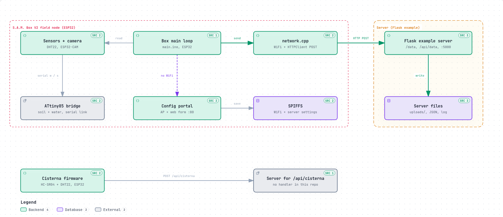

# S.A.M. - Smart Agricultural Monitoring Suite

## Panoramica
S.A.M. (Smart Agricultural Monitor) e' una suite di firmware basati su ESP32 pensata per digitalizzare il monitoraggio di colture, serre e cisterne. In questa cartella sono raccolti i due firmware ufficiali della versione 2.0.0, pensati per lavorare insieme a un server HTTP che riceve immagini, dati ambientali e livelli dell'acqua per analisi e telecontrollo da remoto.

## Architettura



Percorso primario (evidenziato): il loop del firmware Box V2 acquisisce un'immagine JPEG e legge i sensori, poi `network.cpp` invia l'immagine con una POST a `/data` e le misure in JSON a `/api/data` del server Flask di esempio, che le salva su file (`uploads/`, `sensor_data.json`, `sensor_log.txt`). Il diagramma mostra solo ciò che è nel codice di questo repository: non c'è un bot Telegram, e per il firmware Cisterna manca un server di esempio per `/api/cisterna`. Versione interattiva: [`docs/architecture/architecture.html`](docs/architecture/architecture.html), generata con [Archify](https://github.com/tt-a1i/archify) da [`architecture.spec.json`](docs/architecture/architecture.spec.json).

## Contenuto del repository
- `Firmware - S.A.M. Box V2/`: firmware per un nodo di campo con ESP32-CAM, sensori di temperatura, umidita', umidita' del suolo, livello dell'acqua e microcontrollore ATtiny85 per l'interfaccia sensori.
- `Firmware -S.A.M. Cisterna V2/`: firmware per il monitoraggio di cisterne tramite sensore ultrasonico e un DHT22 per temperatura e umidita' ambiente.

Entrambi i progetti includono documentazione tecnica (`docs/`), esempi di server (`examples/`), script di supporto (`scripts/`) e test automatici (`tests/` ove presenti).

## Funzionalita' principali
- Rilevazione multi sensore per parametri ambientali critici.
- Connessione WiFi con riconnessione automatica e watchdog per la stabilita'.
- Portale di configurazione web in modalita' Access Point per impostare credenziali e parametri server.
- Invio periodico dei dati a endpoint HTTP configurabili.
- Memorizzazione su SPIFFS della configurazione e serial commands per diagnostica veloce.

## Firmware S.A.M. Box V2
- **Obiettivo**: monitoraggio del microclima e stato del suolo, con supporto a riprese fotografiche tramite ESP32-CAM per telemetria visiva.
- **Hardware consigliato**: ESP32 WROVER con PSRAM, modulo ESP32-CAM (camera model WROVER KIT), DHT22, sensore di umidita' del suolo analogico, sensore di livello acqua analogico, ATtiny85 come bridge sensori.
- **Pin principali**: DHT22 su GPIO 33, umidita' del suolo su GPIO 32, sensore acqua su GPIO 13, camera secondo `camera_pins.h`.
- **API server**:
  - `POST http://{server}:{porta}/data` (body in JPEG) per le immagini.
  - `POST http://{server}:{porta}/api/data` con payload JSON (temperatura, umidita', umidita' suolo, livello acqua, distanza).

## Firmware S.A.M. Cisterna V2
- **Obiettivo**: controllo del livello dell'acqua in cisterne e silos, con monitoraggio ambientale per temperatura e umidita'.
- **Hardware consigliato**: ESP32 Dev Module, sensore ultrasonico HC-SR04, DHT22, alimentazione 5V stabile.
- **Pin principali**: DHT22 su GPIO 32, TRIG del sensore ultrasonico su GPIO 26, ECHO su GPIO 27.
- **API server**: `POST http://{server}:{porta}/api/cisterna` con payload JSON contenente distanza (cm) e, se disponibili, temperatura e umidita'.

## Preparazione ambiente di sviluppo
1. **Arduino IDE**
   - Aggiungere l'URL `https://dl.espressif.com/dl/package_esp32_index.json` tra le schede aggiuntive.
   - Installare il supporto ESP32 e le librerie: `DHT sensor library`, `ArduinoJson`, `ESPAsyncWebServer`, `AsyncTCP` (per Box V2 le librerie WiFi, HTTPClient ed esp_camera sono gia' incluse con la board).
   - Aprire `src/main.ino` del firmware desiderato, selezionare la board corretta (`ESP32 Wrover Module` per Box, `ESP32 Dev Module` per Cisterna) e caricare.
2. **PlatformIO**
   - Ultilizzare la configurazione descritta nei rispettivi README (cartella firmware) o nel file `platformio.ini` d'esempio.
   - Comandi tipici: `pio run --target upload` per il flash e `pio device monitor -b 9600` per monitorare il log seriale.

## Configurazione iniziale dei dispositivi
1. Alimentare il dispositivo con il firmware caricato.
2. Attendere l'avvio in modalita' configurazione (se non esiste configurazione salvata). Le reti di default sono:
   - Box V2: SSID `ESP32-Access-Point`, password `<la-tua-password>`.
   - Cisterna V2: SSID `SAM-CISTERNA`, password `<la-tua-password>`.
   La password dell'access point di configurazione va scelta dall'utente: il sorgente contiene un valore provvisorio di sviluppo (`configurator.cpp` per il Box, `src/config/config.h` per la Cisterna) che va sostituito con una password propria **prima** di caricare il firmware.
3. Collegarsi alla rete WiFi del dispositivo e aprire `http://192.168.4.1`.
4. Compilare il form con SSID, password della rete domestica e parametri del server HTTP.
5. Salvare: il dispositivo riavvia, memorizza su SPIFFS e tenta la connessione alla WiFi configurata.
6. In qualsiasi momento inviare `C` via serial per tornare in configurazione; i firmware implementano anche logiche automatiche in caso di WiFi non disponibile.

## Integrazione con il server
- Esempio `curl` per il firmware Cisterna:
  ```bash
  curl -X POST -H "Content-Type: application/json" \
    -d '{"distanza": 100, "temperatura": 22.5, "umidita": 60.0}' \
    http://192.168.1.100:5000/api/cisterna
  ```
- Esempio `curl` per il firmware Box (sensori):
  ```bash
  curl -X POST -H "Content-Type: application/json" \
    -d '{"terra":45.2,"acqua":78.5,"distanza":120,"umidita":65.3,"temperatura":22.5}' \
    http://192.168.1.100:5000/api/data
  ```
- Per l'upload immagini dal Box e' necessario un endpoint che accetti `Content-Type: image/jpeg` sul percorso `/data`. Nel repository sono disponibili esempi di server Flask in `examples/`.

## Documentazione e supporto
- Ogni firmware contiene guide hardware, reference API e istruzioni nei file `docs/`.
- `CHANGELOG.md` riporta le modifiche e correzioni per la release 2.0.0.
- Utilizzare i comandi seriali (`V`, `R`, `C`) per verificare versione firmware, riavviare o rientrare in configurazione.

## Licenza
L'intero progetto e' distribuito con licenza MIT; vedere `Firmware - S.A.M. Box V2/LICENSE` e `Firmware -S.A.M. Cisterna V2/LICENSE` per i dettagli.
